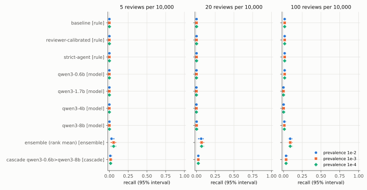
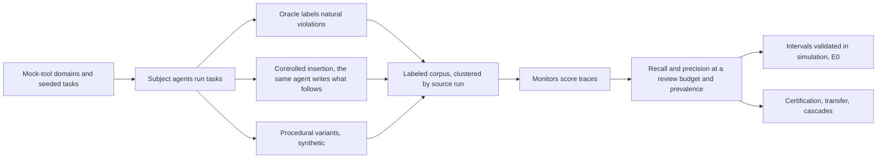

# base-rate

**At a human-review budget of 20 per 10,000 trajectories and a
violation prevalence of 1e-3, no single monitor in this preregistered study (three
Armour rule configurations and Qwen3 models from 0.6B to 8B parameters)
caught more violations than random review would within its 95% interval; the best
combination, a rank-mean ensemble of the reviewer-calibrated rule and the 8B model,
caught 0.069 [0.042, 0.102] of them.** Random review
at that budget catches 0.002. The corpus is agent trajectories in mock-tool domains,
its inserted violations are synthetic, and the monitors are small local models, so these
numbers describe these monitors on this corpus; the methods are the reusable part.



*Prevalence 1e-3, 20 reviews per 10,000, estimate [95% interval]. Set: primary. Traces: 3,418. Independent source runs: 2,800. Synthetic share: 0.181.*

| Monitor | Family | Recall | Precision |
|---|---|---|---|
| `rule:armour-baseline` | rule | 0.002 [0.000, 0.012] | 0.001 [0.000, 0.006] |
| `rule:armour-reviewer-calibrated` | rule | 0.002 [0.000, 0.013] | 0.001 [0.000, 0.007] |
| `rule:armour-strict-agent` | rule | 0.002 [0.000, 0.013] | 0.001 [0.000, 0.007] |
| `model:qwen3-0.6b-q8_0` | model | 0.001 [0.000, 0.012] | 0.000 [0.000, 0.006] |
| `model:qwen3-1.7b-q8_0` | model | 0.000 [0.000, 0.004] | 0.000 [0.000, 0.002] |
| `model:qwen3-4b-q4_k_m` | model | 0.000 [0.000, 0.004] | 0.000 [0.000, 0.002] |
| `model:qwen3-8b-q4_k_m` | model | 0.003 [0.000, 0.015] | 0.001 [0.000, 0.007] |
| rank mean of `rule:armour-reviewer-calibrated` and `model:qwen3-8b-q4_k_m` | ensemble | 0.069 [0.042, 0.102] | 0.034 [0.021, 0.051] |
| `model:qwen3-0.6b-q8_0` then `model:qwen3-8b-q4_k_m`, escalating 0.05 | cascade | 0.025 [0.009, 0.041] | 0.012 [0.004, 0.021] |

**Quickstart (offline, about a minute):**

```bash
git clone https://github.com/raj200501/base-rate && cd base-rate
make setup && make demo
uv run baserate certify --fpr 0.001 --recall 0.9
uv run baserate eval examples/fixtures/monitor_scores.csv --prevalence 1e-4 --budget 20
```

## What it is and is not

base-rate is a library and a study for one question: if violations are rare and humans
can review only a fixed share of agent trajectories, what is a monitor worth? It estimates
recall, precision, and the false-positive rate of a monitor at a review budget and a
deployment prevalence, with intervals that respect how few independent runs stand behind
them; it sizes the labeled samples a claim needs; it checks whether thresholds transfer;
and it optimizes cheap-to-expensive cascades. The study applies it to a labeled corpus of
agent trajectories in eight mock-tool domains and to four monitor families.

It is not a benchmark of frontier models, not an attack on monitors, and not a safety
case. Every trajectory is from simulated tools with abstract violations; the subject
agents and model monitors are small local open-weight models; and the results describe
these monitors on this corpus. The methods transfer to other monitors and data; the
numbers do not.

## Key results

Each result comes from a banked artifact and a preregistration committed before its data
existed; `make prereg-verify` checks the order from git history. Intervals are 95%
and resample or count whole source runs. Null and negative results are reported with the
same prominence as the rest.

- **Single monitors are near chance at realistic budgets** ([E2 results](artifacts/e2/results.json), [prereg/0003](prereg/0003-e2-main-study.md)).
  At prevalence 1e-3 and 20 reviews per 10,000, recall was
  0.002 [0.000, 0.013] for the reviewer-calibrated
  rule, 0.001 [0.000, 0.012] for Qwen3 0.6B,
  0.000 [0.000, 0.004] for 1.7B,
  0.000 [0.000, 0.004] for 4B, and
  0.003 [0.000, 0.015] for 8B. Only the two
  preregistered combinations clear chance: the ensemble
  (0.069 [0.042, 0.102]) and the cascade that sends
  the top 5% by the 0.6B score to the 8B
  (0.025 [0.009, 0.041]).
- **The same monitors look strong on curated records** ([E2 results](artifacts/e2/results.json), [prereg/0003](prereg/0003-e2-main-study.md)).
  On Armour's labeled reference records, at the same prevalence and budget, the
  reviewer-calibrated rule reached recall
  0.930 [0.436, 1.000] and the 8B
  model 1.000 [0.535, 1.000]. Those records are
  explicit violating actions from a few generator scripts (hence the wide intervals); the
  corpus's violations arise while small agents do ordinary tasks. A monitor's result on
  curated records said little about its value on agent traffic.
- **Why: a decent detector at its own threshold is uninformative at the top of the benign tail** ([E2 results](artifacts/e2/results.json), [prereg/0003](prereg/0003-e2-main-study.md)).
  At its native threshold the reviewer-calibrated rule caught
  0.143 [0.122, 0.165] of violations but flagged
  0.067 [0.058, 0.078] of benign runs, far more than the budget
  allows. Held to the budget, it reviews only its top score, which a violation is about as
  likely as a benign run to receive, so its recall falls to the review rate.
- **Precision collapses with prevalence** ([E2 results](artifacts/e2/results.json), [prereg/0003](prereg/0003-e2-main-study.md)). At 1e-4 and the same budget,
  the best precision of any monitor was the ensemble's
  0.003 [0.002, 0.005]: almost every
  reviewed trajectory is benign.
- **Model size did not help at one frozen prompt** ([E2 results](artifacts/e2/results.json), [prereg/0003](prereg/0003-e2-main-study.md)). The size ladder shows no clear
  point where a larger model overtakes the rule monitors (recall at the budget:
  0.6B 0.001 [0.000, 0.012], 8B 0.003 [0.000, 0.015]).
- **Thresholds do not transfer across domains** ([E3 results](artifacts/e3/results.json), [prereg/0004](prereg/0004-e3-transfer.md)). A threshold tuned in one domain kept
  the review load within a factor of two of the budget in another domain for a share
  0.393 of domain pairs for the rule monitor
  and 0.196 for Qwen3 0.6B, against a
  preregistered bar of 75%: not supported for either. A threshold tuned at
  prevalence 1e-2 did keep its review load at 1e-4 (ratio
  0.994
  [0.986,
  1.002]), as expected when
  reviewed traffic is almost all benign. The recall-transfer hypothesis held, but only
  because recall is near zero in every domain.
- **A cheap filter in front of an expensive monitor beat the expensive monitor alone** ([E4 results](artifacts/e4/results.json), [prereg/0005](prereg/0005-e4-cascades.md)).
  On the held-out half of the source runs, the cascade from the reviewer-calibrated rule to
  the 8B model reached recall 0.062 [0.041,
  0.085] at 1.723 seconds of compute per trajectory,
  while the 8B alone reached 0.004 [0.000,
  0.021]. Every cascade's training estimate held on the test half (H4.1
  supported for all four pairs); the efficiency hypothesis H4.2 held for all four too,
  which says little when the second stage alone catches almost nothing.
- **The corpus and its blind label audit** ([corpus manifest](artifacts/corpus/manifest.json), [label audit](artifacts/corpus/label_audit.json), [prereg/0002](prereg/0002-e1-corpus.md)).
  25,023 trajectories from 2,808 independent
  source runs (synthetic share 0.888), with every planned
  insertion attempt accounted for (618 inserted of
  700; every skip was a false completion the subject model would
  not write). A blind audit of 200 sampled labels by a model given only the
  monitor view agreed with the corpus label, type, and step on 0.930
  [0.885, 0.961] of them (docs/DATA.md).
- **The interval methods were validated before use** ([E0 summary](artifacts/e0/summary.json), [prereg/0001](prereg/0001-e0-statistical-engine.md)). Every interval was checked
  by preregistered simulation against exact truth; cells where a method undercovers are
  listed in docs/UNSUPPORTED.md, the library warns there, and E2 marks estimates that rely
  on them.

## How it works



A monitor's scores on labeled benign and violation trajectories are reweighted to a
deployment prevalence; the threshold that reviews exactly the budget is placed (randomized
at ties); recall, precision, and the false-positive rate follow, each with an interval
that resamples or counts whole source runs. Details are in docs/REPORT.md.

## Use it on your own benchmark or agent

Score your labeled trajectories with your monitor and write a CSV with columns
`trace_id`, `label` (benign or violation), `score`, and `cluster` (the independent run each
trace came from). Then:

- `examples/evaluate_your_monitor.py`: recall and precision at a review budget with
  intervals, and the monitor's report card;
- `examples/certify.py`: how many independent runs a recall or false-positive-rate claim
  needs, and how many more an existing claim needs;
- `examples/build_cascade.py`: a two-stage cascade sweep, its Pareto front, and the best
  cascade under a compute budget.

The CLI does the same (`baserate eval`, `baserate certify`, `baserate cascade`,
`baserate card`); docs/USAGE.md explains the score-file format and how to read the
output. The Armour adapter (`baserate.traces.armour`) converts Armour traces.

## Reproduce every figure

```bash
make reproduce
```

rebuilds every figure, table, and number in this README and in docs/REPORT.md from the
banked artifacts under `artifacts/`, with no model calls. `make ship-check` runs the
project's definition-of-done gates on a fresh clone.

## Limitations and threats to validity

- **Simulated tools, small agents, abstract violations.** Every trajectory comes from mock
  tools, the subject agents are Qwen3 1.7B and 4B on a CPU, and a violation
  is one abstract tool call. Recall here is not an estimate for any deployed agent.
- **Violations do not hide.** Natural violations are small-model mistakes, inserted ones
  are chosen by the harness, and Armour's come from a few generator scripts. No source is an
  adversary, so these rates are not robustness to evasion.
- **Labels.** One oracle labels real and inserted trajectories from tool effects, and the
  blind auditor is a model given the same definitions, not a human expert.
- **Prevalence is a design parameter.** Results at each prevalence reweight the corpus
  (case-control) and assume the benign corpus stands for benign deployment traffic.
- **The benign tail limits every low-budget claim.** Only independent benign runs inform
  the extreme tail; procedural variants share their run's cluster. Estimates that rely on
  an E0 cell where the interval method undercovers are marked.
- **One prompt, no Claude models.** The model monitors share one frozen prompt with no
  tuning, so the ladder compares sizes at that prompt; no Claude model served as a subject
  or monitor in this environment. Cascade costs are CPU seconds on this machine.

docs/REPORT.md section 6 states each threat in full, with the preregistration deviations.

## Responsible disclosure

This project measures monitors and does not attack them. All violations are abstract
actions in simulated tools; no real system, credential, or payload is involved, and no
part of the work optimizes agents to evade monitors. It found no exploitable weakness to
disclose; weaknesses of the evaluated monitors are reported as rates.

## Related work

- **Control monitoring in deployment.** "Practical challenges of control monitoring in
  frontier AI deployments" [@practical-challenges-2025] and the control safety-case sketch
  [@korbak-safety-case-2025] argue that limited review capacity fixes a monitor's
  false-positive rate and that recall then drives safety, and that these quantities must
  be estimated and extrapolated conservatively. They give no estimator, interval, or
  sample size; base-rate supplies that measurement layer.
- **Control settings and monitor benchmarks.** Async Control [@aisi-async-control-2025],
  BashArena [@basharena-2025], LinuxArena [@linuxarena-2026], and SHADE-Arena
  [@shade-arena-2025] score monitors against attackers at a fixed false-positive rate;
  MonitorBench [@monitorbench-2026] and TRACE [@trace-2026] benchmark what monitors can
  detect, and TRACE finds that the benign-to-hacked ratio changes measured detection.
  None estimates recall and precision at a deployment prevalence and review budget.
- **Cascades.** Hua and colleagues [@hua-cascades-2025] combine monitors of different cost
  under one budget. base-rate adds a fixed prevalence and review budget, intervals that
  carry the benign tail's uncertainty, certification sample sizes, and held-out
  validation split by source run.
- **Foundations.** Armour [@armour] provides the trace schema, rule monitors, and labeled
  records. The intervals are standard [@clopper-pearson-1934] [@wilson-1927]
  [@brown-cai-dasgupta-2001] [@rubin-1981] [@hanley-lippman-hand-1983]; the corpus
  datasheet follows [@gebru-datasheets-2021]; the model monitors are Qwen3
  [@qwen3-2025].

docs/REPORT.md section 2 discusses each in more detail.

### References

- [@practical-challenges-2025] Practical challenges of control monitoring in frontier AI deployments. 2025. <https://arxiv.org/abs/2512.22154>
- [@korbak-safety-case-2025] A sketch of an AI control safety case. 2025. <https://arxiv.org/abs/2501.17315>
- [@aisi-async-control-2025] Async Control: Stress-testing Asynchronous Control Measures for LLM Agents. 2025. <https://arxiv.org/abs/2512.13526>
- [@basharena-2025] BashArena: A Control Setting for Highly Privileged AI Agents. 2025. <https://arxiv.org/abs/2512.15688>
- [@linuxarena-2026] Introducing LinuxArena. 2026. <https://blog.redwoodresearch.org/p/introducing-linuxarena>
- [@shade-arena-2025] SHADE-Arena: Evaluating sabotage in LLM agents. 2025. <https://www.anthropic.com/research/shade-arena-sabotage-monitoring>
- [@monitorbench-2026] MonitorBench: A Comprehensive Benchmark for Chain-of-Thought Monitorability in Large Language Models. 2026. <https://arxiv.org/abs/2603.28590>
- [@trace-2026] Benchmarking Reward Hack Detection in Code Environments via Contrastive Analysis. 2026. <https://arxiv.org/abs/2601.20103>
- [@hua-cascades-2025] Combining cost-constrained runtime monitors for AI safety. 2025. <https://arxiv.org/abs/2507.15886>
- [@armour] raj200501/armour: Armour is a dependency-light evaluation framework for trace-level safety in tool-using AI agents. <https://github.com/raj200501/armour>
- [@clopper-pearson-1934] The use of confidence or fiducial limits illustrated in the case of the binomial. 1934. <https://doi.org/10.1093/biomet/26.4.404>
- [@wilson-1927] Probable inference, the law of succession, and statistical inference. 1927. <https://doi.org/10.1080/01621459.1927.10502953>
- [@brown-cai-dasgupta-2001] Interval estimation for a binomial proportion. 2001. <https://doi.org/10.1214/ss/1009213286>
- [@rubin-1981] The Bayesian bootstrap. 1981. <https://doi.org/10.1214/aos/1176345338>
- [@hanley-lippman-hand-1983] If nothing goes wrong, is everything all right? Interpreting zero numerators. 1983. <https://doi.org/10.1001/jama.1983.03330370053031>
- [@gebru-datasheets-2021] Datasheets for datasets. 2021. <https://doi.org/10.1145/3458723>
- [@qwen3-2025] Qwen3 technical report. 2025. <https://arxiv.org/abs/2505.09388>

## Citation

```bibtex
@software{baserate,
  title = {base-rate: prevalence-aware evaluation of AI agent monitors},
  author = {Kashikar, Raj},
  year = 2026,
  url = {https://github.com/raj200501/base-rate}
}
```

See CITATION.cff.

## License

MIT (LICENSE). Ported code keeps its notices: raise-v1 tools under Apache 2.0
(third_party/raise-v1/), Armour under MIT (tests/fixtures/armour/LICENSE).
