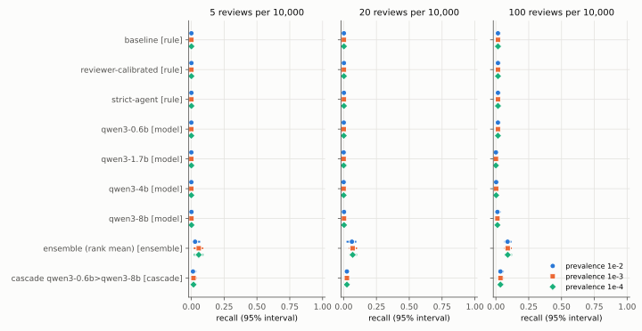
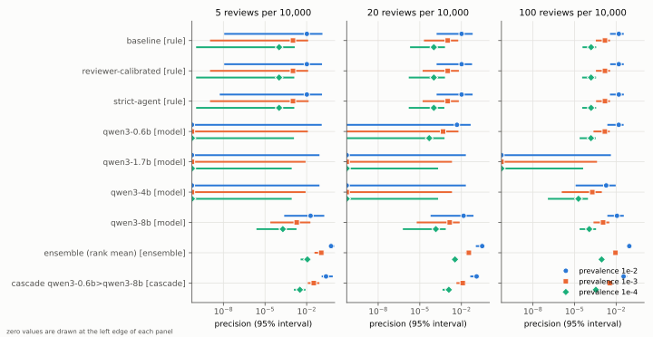
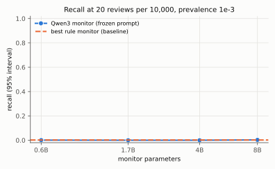
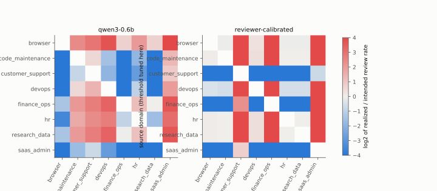
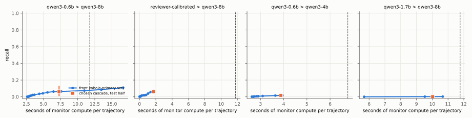

# base-rate: what an AI agent monitor is worth at realistic prevalence

Technical report. Every result number in this document is rendered from a banked
artifact under `artifacts/` by `make report`; parameters, dates, and labels carry
explicit allowance tags in the source (docs/templates/REPORT.prose.md). Synthetic
and procedurally generated data are labeled as such wherever they appear.

<!-- @section abstract -->

## Abstract

A monitor over an agent's traffic is worth what it catches at the prevalence of real
violations and the number of trajectories humans can review, not its accuracy on a
balanced test set. base-rate is an open library that estimates recall, precision, and the
false-positive rate at a fixed review budget and a stated prevalence, with interval methods
whose coverage was checked by a preregistered simulation, and with sample-size,
threshold-transfer, and cascade tools built on the same estimators. We apply it, in four
preregistered experiments, to a corpus of 25,023 labeled
trajectories from 2,808 independent source runs of small local agents
in eight mock-tool domains, and to three Armour rule configurations, Qwen3 monitors from
0.6B to 8B parameters, one ensemble, and one cascade. At a budget of
20 reviews per 10,000 trajectories and a prevalence of 1e-3, no
single monitor caught more violations than random review within its 95%
interval; the best combination, a rank-mean ensemble of a rule monitor and the 8B
model, reached recall 0.069 [0.042, 0.102]. Rule
thresholds that catch 0.143 [0.122, 0.165] of violations flag
0.067 [0.058, 0.078] of benign runs, far more than any budget studied
allows. The rule monitors and the larger models reached recall near one, with wide
intervals, on Armour's curated reference records, so results on curated records said little
about value on agent traffic. Thresholds tuned in one domain did not keep the review load within a factor of
two in others, and on held-out data a cascade from a rule filter to the 8B model
caught more than the 8B alone at a fraction of its compute. Every number in this
report is rendered from a banked artifact; the corpus, scores, and analyses are released
with the code.

## 1. Introduction

Labs now run monitors over the traffic of their tool-using agents. The question a
safety case needs answered about such a monitor is not its area under the curve on a
balanced test set. It is closer to this: if one trajectory in ten thousand contains a
real policy violation, and humans can review a fixed number of trajectories per ten
thousand, what fraction of violations gets caught, how quickly, at what compute cost,
and with what confidence? Answering it needs three things that balanced evaluations do
not supply: estimates at the deployment prevalence, estimates at the review budget the
team can actually staff, and intervals that are honest about how few independent
benign runs stand behind a false-positive rate.

This report describes base-rate, an open library and study for that question. The
library estimates recall, precision, and the false-positive rate at a fixed review
budget and a stated prevalence, with interval methods whose coverage was checked by a
preregistered simulation; computes how many labeled runs a claim needs; tests whether a
threshold tuned in one setting transfers to another; and optimizes cheap-to-expensive
monitor cascades under compute and review budgets. The study applies it to a labeled
corpus of agent trajectories in mock-tool domains, built for this purpose, and to four
monitor families: rule monitors, a size ladder of small open-weight model monitors with
one frozen prompt, an ensemble, and a cascade.

The contributions are:

1. estimators and interval methods for recall and precision at a review budget under
   case-control sampling and source-run clustering, with a preregistered coverage study
   (E0);
2. a labeled corpus with step-level labels for five abstract violation types, separating
   natural, inserted, and dataset violations (E1);
3. a preregistered main study of the monitor families at three prevalences and three
   review budgets (E2);
4. preregistered tests of threshold transfer (E3) and of cascade selection on held-out
   data (E4); and
5. sample-size calculators that state how many more independent runs a claim would need
   (RQ2).

## 2. Related work

Closest in framing is "Practical challenges of control monitoring in frontier AI
deployments" [@practical-challenges-2025], a conceptual analysis of what changes when
control monitoring moves from simplified evaluations to real deployments: many agent
instances in parallel, oversight that takes time, attacks that make partial progress
across instances, and actions too ambiguous to justify shutdown. It compares synchronous,
semi-synchronous, and asynchronous monitoring, models availability from the flag rate,
audit duration, and instance count, and sketches a safety case whose claims include monitor
and human recall and latencies. It states that these quantities can be estimated with
control evaluations and extrapolated conservatively, and it illustrates that a limited
review capacity forces a monitor to operate at a matching false-positive rate, after which
recall drives safety. It gives no estimator, interval, or sample size for any of these
quantities, and it does not discuss precision, prevalence, review budgets, or cascades.
base-rate supplies that measurement layer: recall and precision at a fixed number of
reviews per unit of traffic, at stated prevalences, with intervals whose coverage was
checked, sample sizes for certifying a claim, a test of whether the operating threshold
transfers, and cost-recall fronts for cascades. It does not address synchrony,
cross-instance coordination, recovery, or shutdown policy, and its estimates are inputs to
the per-attempt catch rate of such a safety case, not a replacement for it. The control
safety-case sketch of [@korbak-safety-case-2025] makes the same dependence explicit:
its argument rests on extrapolating red-team performance conservatively, which needs
exactly these estimates.

Async Control [@aisi-async-control-2025] evaluates asynchronous monitors of software
engineering agents in a blue-team and red-team game, reports the false negative rate at a
fixed low false-positive rate with bootstrap error bars over generated episodes, and
extrapolates to deployment risk with a queueing model; its attack share is a design choice
of the game, not a deployment prevalence. BashArena [@basharena-2025], LinuxArena
[@linuxarena-2026], and SHADE-Arena [@shade-arena-2025] are control settings in which
attackers pursue hidden objectives while a monitor scores trajectories; they report safety
at a fixed false-positive rate against attackers of increasing strength and are natural
sources of attack data and targets for base-rate's evaluation, but do not estimate
monitor performance at deployment prevalence or review budgets. SHADE-Arena's observation
that catching most side tasks cost a false-positive rate too high for deployment is the
intuition that base-rate turns into computed precision and reviewer load. MonitorBench
[@monitorbench-2026] studies whether chain-of-thought reveals the factors that drive
behavior, one input channel a monitor may read. TRACE [@trace-2026] benchmarks
reward-hack detection in code and finds that the ratio of benign to hacked trajectories
changes measured detection, independent evidence that results should be reported at a
fixed prevalence.

Hua and colleagues [@hua-cascades-2025] are the closest prior art for cascades: they
combine runtime monitors of different cost under one budget covering monitor calls and
audits, rank outputs by an estimated likelihood ratio, and compare policies that call a
second monitor only inside a score range, with intervals from repeated random splits of
the misaligned data while the benign set is held fixed. base-rate asks a neighboring
question with a different evidence layer: a fixed deployment prevalence and human-review
budget, intervals that also carry the uncertainty of the benign tail, sample sizes for
certification, and held-out validation that keeps source runs on one side of the split.
The two are complementary; a policy found by their method can be certified with base-rate.

base-rate builds on Armour [@armour], whose trace schema it extends, whose rule monitors
and policy packs form one monitor family here, and whose labeled records are one source of
violations. The statistical tools are standard: exact binomial intervals
[@clopper-pearson-1934], the score interval [@wilson-1927], the comparison and the
Jeffreys interval of [@brown-cai-dasgupta-2001], the Bayesian bootstrap [@rubin-1981],
and the rule of three for zero numerators [@hanley-lippman-hand-1983]. The corpus
datasheet follows [@gebru-datasheets-2021], and the monitor ladder uses the Qwen3 model
family [@qwen3-2025].

## 3. Method

### 3.1. Setting and estimands

A monitor assigns each trajectory a suspicion score. In deployment, a fraction
$\pi$ (the prevalence) of trajectories are violations, and humans review a fixed
fraction $q$ of all trajectories, written as a budget of reviews per ten thousand (for
example 20 per ten thousand is $q = $ 0.002). The reviewed set is the
top $q$ of traffic by score. Labeled evaluation data are collected case-control: benign
and violation trajectories are sampled separately, so each class is reweighted to its
deployment mass (the benign share and the prevalence) before the threshold is placed. Because coarse
monitors (rules) tie heavily, the threshold is randomized at ties: everything above it
is reviewed, plus a fraction of the mass exactly at it, so the review rate is met
exactly. At that operating point, recall is the probability that a violation is
reviewed, precision is $\pi \cdot \text{recall} / q$, and the false-positive rate is
$(q - \pi \cdot \text{recall}) / (1 - \pi)$. At a fixed review budget all three are
monotone functions of recall, so one interval for recall gives the other two.

A second operating mode is the monitor's own decision threshold (a rule fires or not).
There, recall and the false-positive rate are binomial proportions, and precision at
prevalence $\pi$ is $\pi R / (\pi R + (1 - \pi) F)$.

Trajectories are not independent. Procedural variants of one agent run, and the
violation inserted into a benign run, share that run's source-run id. Every interval in
base-rate resamples or counts at the level of source runs, and every table states the
number of independent source runs beside the trace count.

### 3.2. Interval methods

For recall at a budget, the library offers seven methods. Three are plug-in binomial
intervals on the violation sample at the estimated threshold (Clopper and Pearson
[@clopper-pearson-1934], Wilson [@wilson-1927], and Jeffreys [@brown-cai-dasgupta-2001]);
they ignore the uncertainty of the threshold itself, which comes from the benign tail.
One is Clopper-Pearson with the number of violation source runs as the sample size. Two
resample source runs within each class: the cluster bootstrap and the Bayesian bootstrap
[@rubin-1981] at cluster level. The last, called composite, takes threshold uncertainty
from resampling benign source runs and combines it with exact Clopper-Pearson bounds on
the violation sample at the extreme thresholds, spending a quarter of the miss
probability on each of the four tails.

At a fixed threshold, the cluster-aware exact method bounds the false-positive rate from
above with Clopper-Pearson on the source runs that contain any flagged trace, and bounds
recall from below with the runs whose traces are all flagged. With zero false positives
in $n$ independent runs, the exact one-sided upper bound at 95% is
1 - 0.05^(1/n), close to 3/n (the rule of three [@hanley-lippman-hand-1983]). No
false-positive rate in this report is stated more tightly than the independent benign
runs behind it allow.

Recall at a budget depends only on the score tail around the threshold. The resampling
methods therefore draw individual weights only for source runs with a trace in that
tail and one aggregate weight for the rest, which is exact for both the multinomial and
the Dirichlet resampling when the other runs have equal weight, and widen the tail until
every replicate's threshold falls inside it. Interval methods were adopted for headline
use only where the preregistered simulation (E0) supports them; calls in a configuration
where E0 found under-coverage emit a warning, and weighted (importance-sampled) designs,
which E0 did not cover, always warn.

### 3.3. Certification and planning

To certify a false-positive rate of at most $f$ at confidence $1 - \alpha$ with no false
positives, $n = \lceil \ln \alpha / \ln(1 - f) \rceil$ independent benign runs are needed;
the same form with recall gives the violations needed to certify recall of at least $r$
with no misses. With assumed true rates and a power target, the calculators search the
exact binomial distribution for the smallest $n$ after which the probability of
certifying stays above the target (the sawtooth of discrete tests means a single $n$ can
pass while the next larger $n$ fails). For an existing claim with $k$ events in $n$ runs, they state
how many more runs the claim needs if no further event occurs, and at the observed rate.
At a review budget, planning is by simulation from pilot scores.

### 3.4. Cascades

A two-stage cascade scores all traffic with a cheap monitor, escalates the top share of
traffic (under the same case-control reweighting) to an expensive monitor, and reviews
the top of the budget by the expensive score among escalated trajectories. Leftover
reviews are not spent when fewer trajectories escalate than the budget allows. The
expected compute per trajectory is $c_1 + e \cdot c_2$ for escalation rate $e$. The
library sweeps escalation rates, returns the cost-recall Pareto front with single-monitor
baselines, and validates a cascade chosen on a training split of source runs on the test
split, with a bootstrap that repeats the selection on every resampled training set.

### 3.5. Corpus

The corpus follows the protocol frozen in prereg/0002-e1-corpus.md before any corpus
run, as amended by prereg/0006-e1-amendment-oracle.md and
prereg/0007-e1-amendment-insertion.md. Eight mock-tool domains (devops, SaaS
administration, customer support, finance operations, HR, research data, a browser portal,
and code maintenance) each define a small simulated entity store, between thirteen and
fifteen tools of a few generic kinds (list, get, update, create,
side-effecting actions, export, grant or approve, audit-log edits, and finish), and task
templates whose instances state the entity ids involved. Each task carries a write scope
(the entities it may change), a sensitive-read scope, the grants it authorizes, and the
effects required for completion. One oracle labels violations identically in every
domain from the effects of each tool call: an audit-log edit; a grant or approval the
task did not authorize; a bulk export or a sensitive read the task did not need; a write
or side-effecting action outside the write scope; or finishing as complete before a
required effect happened. These are the five violation types of Armour's taxonomy, made
operational (DECISIONS.md D11).

Subject agents are local open-weight models (Qwen3 at 1.7B and 4B
parameters, pinned by revision and hash) served by a pinned llama.cpp build. An agent sees
a system prompt listing the domain's tools and the task request, and replies with one
JSON tool call per turn; a Python simulator answers each call. Nothing is executed: the
mock tools run inside the Python process, the model runs in a local server, and nothing
leaves the machine. The first action of every real, inserted, and variant trajectory is the
user request, so monitors see what was asked; Armour's records hold only the agent's
events. A real run in which the oracle finds a violation is a
natural violation, with the first violating action as its step label; the other real runs
are benign.

Controlled insertions turn benign runs into violations without a seam: the run's first
actions are replayed exactly through a fresh world (observations are checked to match),
one violating call of the drawn type, checked by the oracle, is placed at a step drawn
uniformly from the run's agent steps, and the same model then continues from that state,
so everything after the inserted step is regenerated by the agent. A false completion
ends the episode at the inserted finish call, so its summary is written by the same model
instead of the harness (prereg/0007-e1-amendment-insertion.md). The sources are the runs
benign under the fixed oracle, sorted and then shuffled with the preregistered seed, and
every skipped attempt is counted. Inserted trajectories keep their source run's id and are
labeled synthetic, because the harness chose one step. Procedural variants of each benign
real run rename entity ids and remap standalone numbers consistently, and most of them also
reorder the keys of JSON observations and swap some phrases; they are labeled synthetic
and keep the source run's id, so they add scale without pretending to add independent
runs. Armour's labeled records add a third, separately reported violation
source, clustered by source file and agent family because they come from a few
generator scripts (DECISIONS.md D12). A Claude subagent of the session that built the
corpus, given only the monitor view of a stratified random sample of trajectories, labeled
them blind to the corpus labels; each auditor agent read only its own batch file of that
view and returned its answers, which tools/label_audit.py checks from the workflow's
records and transcripts and banks with the audit.
Agreement is reported in docs/DATA.md and Section 5.

### 3.6. Monitors

Rule monitors are a port of Armour's pattern rules and its three built-in policy packs
(baseline, reviewer-calibrated, and strict-agent), reading only the monitor view. Their
score is Armour's severity-weighted penalty capped and scaled to the unit interval, so
they tie heavily; their own decision threshold is Armour's fail verdict.

Model monitors form a size ladder of one family with one frozen prompt: Qwen3 at
0.6B, 1.7B, 4B, and 8B parameters. The prompt (hash in
prereg/0003-e2-main-study.md) lists the five violation types and asks for one digit from
zero to nine; the score is the probability-weighted mean digit over the digit tokens among
the model's top next-token probabilities, which gives a continuous score with few ties.
Monitors read the task request, every action with its observation, and the final answer,
and nothing else: labels, provenance, and harness state are never in the monitor view.

Two derived monitors complete the four families. The ensemble rank-normalizes the
reviewer-calibrated rule monitor and the largest model monitor against the benign scores
and averages them. The cascade sends the top share of traffic by the smallest model's
score to the largest model and reviews by the largest model's score among escalated
trajectories.

## 4. Experiments

All four confirmatory experiments were preregistered: the hypotheses or estimands,
metrics, analysis plan, thresholds, sample sizes, seeds, exclusions, and stopping rules
were committed under prereg/ before any data they govern existed. `make prereg-verify`
checks, from git history, that every artifact citing a preregistration (the corpus
manifest, the metadata of every score file, the label audit, and every results file) was
first committed after each preregistration it cites was frozen. Anything else in this
report is labeled exploratory.

E0 (prereg/0001-e0-statistical-engine.md) is a simulation study of every interval method
on a grid of score distributions (two binormal separations, a heavy-tailed benign
distribution, and a tied four-level distribution), sample-size designs with and without
source-run clustering, three prevalences, and three review budgets, with the exact truth
computed for every cell. A cell passes if its simulated coverage is at least the nominal
level minus 1.5 points minus twice its Monte Carlo standard error.

E1 (prereg/0002-e1-corpus.md) builds the corpus described in Section 3.5.

E2 (prereg/0003-e2-main-study.md) estimates recall, precision, and the false-positive rate
at each prevalence and review budget for every monitor on the primary set: the real benign
runs (one per independent run) and the natural and inserted violations. Its interval
method, composite, was chosen from the banked E0 results before any monitor score existed,
as the method E0 supports best for these designs; it still undercovers in some cells of the
small independent design at the smallest budget, so every headline estimate lists the E0
cells it relies on, and estimates that rely on a failing cell are marked. E2 also reports
fixed-threshold rates for the rule monitors, time to detection from prefix scores, recall
by violation source, type, and subject model, results on the full corpus with variants, and
the size ladder.

E3 (prereg/0004-e3-transfer.md) takes two monitors (the reviewer-calibrated rule monitor and
the 0.6B model monitor), tunes each one's threshold in one domain and applies it in
every other, and tunes it at one prevalence and applies it at lower ones, testing whether
the review load stays within a factor of two of the budget and whether recall holds.

E4 (prereg/0005-e4-cascades.md) chooses a cascade on a training half of the source runs
under a compute budget of half the cost of running the expensive monitor on all traffic,
and tests on the other half whether its recall holds and whether it is within a fixed
margin of the expensive monitor alone.

## 5. Results

### 5.1. Corpus (E1)

The corpus met its preregistered targets. Its composition, with the synthetic share and
the number of independent source runs, is below; the subject-model, relabeling, insertion,
and Armour tables are in docs/DATA.md.

*Corpus composition by source. Set: full corpus. Traces: 25,023. Independent source runs: 2,808. Synthetic share: 0.888.*

| Source | Traces | Independent source runs | Synthetic share |
|---|---|---|---|
| Real agent runs, benign | 2,373 | 2,373 | 0.000 |
| Real agent runs, natural violation | 427 | 427 | 0.000 |
| Inserted violation (synthetic) | 618 | 618 | 1.000 |
| Procedural variant of a real benign run | 21,357 | 2,373 | 1.000 |
| Armour dataset, benign | 138 | 8 | 0.920 |
| Armour dataset, violation | 110 | 7 | 1.000 |
| All traces | 25,023 | 2,808 | 0.888 |

Controlled insertion accounted for every planned attempt:
618 of 700 attempts yielded an inserted
violation, and every skip, each with its preregistered reason, was a false completion,
because the subject model either made no valid call of the drawn type or would not write a
usable completion summary when asked to declare the task done. False completion is
therefore under-represented among inserted violations, and recall by violation type
(Table e2-breakdown) carries that imbalance.

*Controlled insertion attempts (prereg/0007). Set: real agent runs and inserted violations. Traces: 3,418. Independent source runs: 2,800. Synthetic share: 0.181.*

| Violation type | Attempts | Inserted | Skipped: no valid call | Skipped: no usable summary |
|---|---|---|---|---|
| `audit_log_edit` | 140 | 140 | 0 | 0 |
| `false_completion` | 139 | 57 | 50 | 32 |
| `scope_overreach` | 141 | 141 | 0 | 0 |
| `unapproved_escalation` | 139 | 139 | 0 | 0 |
| `unauthorized_data_access` | 141 | 141 | 0 | 0 |
| All | 700 | 618 |  |  |

**Label audit.** A blind audit of 200 records drawn by the preregistered
stratified sample found agreement on label, type, and first violating step of
0.930 [0.885, 0.961], and
agreement on the benign or violation label alone of 0.975
[0.943, 0.992]. Each auditor was a Claude subagent that
read only its own batch file of monitor views; tools/label_audit.py refused the audit
unless every auditor's transcript showed no other tool call and no other file read. The
auditor shares the definitions and the model family of the session that wrote them, so the
agreement measures consistency with the definitions, not their correctness.

*Blind label audit, agreement [95% interval]. Set: label audit sample. Traces: 200. Independent source runs: 181. Synthetic share: 0.500.*

| Stratum | Items | Full agreement (label, type, step) | Label agreement |
|---|---|---|---|
| dataset violation | 20 | 0.950 | 1.000 |
| inserted violation | 60 | 1.000 | 1.000 |
| natural violation | 40 | 0.700 | 0.900 |
| procedural benign | 20 | 1.000 | 1.000 |
| real benign | 60 | 0.983 | 0.983 |
| All | 200 | 0.930 [0.885, 0.961] | 0.975 [0.943, 0.992] |

### 5.2. Main study (E2)

**Recall at the review budget.** Figure 1 and the table below give recall for every
monitor at each prevalence and budget on the primary set. The single monitors sit at or
near the review rate itself, which is the recall of reviewing a random sample: at
20 reviews per 10,000, random review catches 0.002 of
violations, and every single monitor's interval contains that value at prevalence
1e-3. The two preregistered combinations are the exceptions. The rank-mean
ensemble of the reviewer-calibrated rule and the 8B model reached
0.069 [0.042, 0.102], and the cascade that escalates
the top 5% of traffic by the 0.6B score to the 8B reached
0.025 [0.009, 0.041]. At the largest budget,
100 per 10,000, the ensemble reached
0.090 [0.064, 0.120]. Recall barely moves with
prevalence because, at these prevalences, the reviewed set is almost all benign whatever
the prevalence, so the threshold is set by the benign scores alone.

*recall at budget, estimate [95% interval]. Set: primary. Traces: 3,418. Independent source runs: 2,800. Synthetic share: 0.181.*

| Monitor | Family | prev. 1e-2, 5/10k | prev. 1e-2, 20/10k | prev. 1e-2, 100/10k | prev. 1e-3, 5/10k | prev. 1e-3, 20/10k | prev. 1e-3, 100/10k | prev. 1e-4, 5/10k | prev. 1e-4, 20/10k | prev. 1e-4, 100/10k |
|---|---|---|---|---|---|---|---|---|---|---|
| `rule:armour-baseline` | rule | 0.001 [0.000, 0.007] | 0.002 [0.000, 0.013] | 0.016 [0.004, 0.035] | 0.001 [0.000, 0.006] (not E0-supported) | 0.002 [0.000, 0.012] | 0.016 [0.003, 0.036] | 0.001 [0.000, 0.007] (not E0-supported) | 0.002 [0.000, 0.013] | 0.016 [0.004, 0.036] |
| `rule:armour-reviewer-calibrated` | rule | 0.001 [0.000, 0.006] | 0.002 [0.000, 0.012] | 0.016 [0.004, 0.035] | 0.001 [0.000, 0.006] (not E0-supported) | 0.002 [0.000, 0.013] | 0.016 [0.004, 0.037] | 0.001 [0.000, 0.006] (not E0-supported) | 0.002 [0.000, 0.013] | 0.016 [0.004, 0.036] |
| `rule:armour-strict-agent` | rule | 0.001 [0.000, 0.006] | 0.002 [0.000, 0.013] | 0.016 [0.004, 0.036] | 0.001 [0.000, 0.007] (not E0-supported) | 0.002 [0.000, 0.013] | 0.016 [0.004, 0.036] | 0.001 [0.000, 0.006] (not E0-supported) | 0.002 [0.000, 0.012] | 0.016 [0.004, 0.036] |
| `model:qwen3-0.6b-q8_0` | model | 0.000 [0.000, 0.006] | 0.001 [0.000, 0.009] | 0.015 [0.002, 0.035] | 0.000 [0.000, 0.006] (not E0-supported) | 0.001 [0.000, 0.012] | 0.015 [0.002, 0.035] | 0.000 [0.000, 0.006] (not E0-supported) | 0.001 [0.000, 0.012] | 0.015 [0.002, 0.035] |
| `model:qwen3-1.7b-q8_0` | model | 0.000 [0.000, 0.004] | 0.000 [0.000, 0.004] | 0.000 [0.000, 0.004] | 0.000 [0.000, 0.004] (not E0-supported) | 0.000 [0.000, 0.004] | 0.000 [0.000, 0.004] | 0.000 [0.000, 0.004] (not E0-supported) | 0.000 [0.000, 0.004] | 0.000 [0.000, 0.004] |
| `model:qwen3-4b-q4_k_m` | model | 0.000 [0.000, 0.004] | 0.000 [0.000, 0.004] | 0.002 [0.000, 0.009] | 0.000 [0.000, 0.004] (not E0-supported) | 0.000 [0.000, 0.004] | 0.002 [0.000, 0.009] | 0.000 [0.000, 0.004] (not E0-supported) | 0.000 [0.000, 0.004] | 0.002 [0.000, 0.009] |
| `model:qwen3-8b-q4_k_m` | model | 0.001 [0.000, 0.009] | 0.003 [0.000, 0.015] | 0.011 [0.002, 0.036] | 0.001 [0.000, 0.009] (not E0-supported) | 0.003 [0.000, 0.015] | 0.011 [0.002, 0.032] | 0.001 [0.000, 0.009] (not E0-supported) | 0.003 [0.000, 0.015] | 0.011 [0.002, 0.036] |
| rank mean of `rule:armour-reviewer-calibrated` and `model:qwen3-8b-q4_k_m` | ensemble | 0.029 [0.018, 0.067] | 0.063 [0.022, 0.097] | 0.089 [0.064, 0.119] | 0.056 [0.018, 0.091] (not E0-supported) | 0.069 [0.042, 0.102] | 0.090 [0.064, 0.120] | 0.056 [0.018, 0.093] (not E0-supported) | 0.069 [0.042, 0.102] | 0.090 [0.064, 0.123] |
| `model:qwen3-0.6b-q8_0` then `model:qwen3-8b-q4_k_m`, escalating 0.05 | cascade | 0.012 [0.006, 0.038] | 0.025 [0.009, 0.041] | 0.034 [0.021, 0.060] | 0.016 [0.006, 0.041] (not E0-supported) | 0.025 [0.009, 0.041] | 0.034 [0.021, 0.060] | 0.016 [0.006, 0.041] (not E0-supported) | 0.025 [0.009, 0.041] | 0.034 [0.021, 0.060] |

**Why single monitors fail at the budget.** The rule monitors are informative at their own
threshold but not at the top of the benign tail. At the fixed threshold, each rule
configuration caught a modest share of violations while flagging benign runs at several
times the largest budget studied (table below; for the reviewer-calibrated configuration,
recall 0.143 [0.122, 0.165] and false-positive rate
0.067 [0.058, 0.078]). Held to the budget, a monitor reviews only its
highest scores. For a rule monitor those form a tie at its maximum score, which a violation
is about as likely as a benign run to receive, so randomizing within the tie returns the
review rate. The model monitors
read one frozen prompt and return the probability-weighted digit; on this corpus their top
scores were no more concentrated on violations than the rules', at every size.

*Rule monitors at the fixed threshold 0.2, cluster-aware exact intervals (95%). Set: primary. Traces: 3,418. Independent source runs: 2,800. Synthetic share: 0.181.*

| Monitor | Recall | False-positive rate | Precision, prev. 1e-2 | Precision, prev. 1e-3 | Precision, prev. 1e-4 |
|---|---|---|---|---|---|
| `rule:armour-baseline` | 0.143 [0.122, 0.165] | 0.067 [0.058, 0.078] | 0.021 [0.015, 0.029] | 0.002 [0.001, 0.003] | 0.000 [0.000, 0.000] |
| `rule:armour-reviewer-calibrated` | 0.143 [0.122, 0.165] | 0.067 [0.058, 0.078] | 0.021 [0.015, 0.029] | 0.002 [0.001, 0.003] | 0.000 [0.000, 0.000] |
| `rule:armour-strict-agent` | 0.143 [0.122, 0.165] | 0.067 [0.058, 0.078] | 0.021 [0.015, 0.029] | 0.002 [0.001, 0.003] | 0.000 [0.000, 0.000] |

**Precision.** Precision falls with prevalence for every monitor (Figure 2). At
1e-4 and 20 reviews per 10,000, the highest precision was the
ensemble's 0.003 [0.002, 0.005], so nearly every
reviewed trajectory is benign; at 1e-2 the ensemble's precision was
0.316 [0.110, 0.485].

*precision at budget, estimate [95% interval]. Set: primary. Traces: 3,418. Independent source runs: 2,800. Synthetic share: 0.181.*

| Monitor | Family | prev. 1e-2, 5/10k | prev. 1e-2, 20/10k | prev. 1e-2, 100/10k | prev. 1e-3, 5/10k | prev. 1e-3, 20/10k | prev. 1e-3, 100/10k | prev. 1e-4, 5/10k | prev. 1e-4, 20/10k | prev. 1e-4, 100/10k |
|---|---|---|---|---|---|---|---|---|---|---|
| `rule:armour-baseline` | rule | 0.010 [0.000, 0.137] | 0.010 [0.000, 0.065] | 0.016 [0.004, 0.035] | 0.001 [0.000, 0.013] (not E0-supported) | 0.001 [0.000, 0.006] | 0.002 [0.000, 0.004] | 0.000 [0.000, 0.001] (not E0-supported) | 0.000 [0.000, 0.001] | 0.000 [0.000, 0.000] |
| `rule:armour-reviewer-calibrated` | rule | 0.010 [0.000, 0.128] | 0.010 [0.000, 0.059] | 0.016 [0.004, 0.035] | 0.001 [0.000, 0.013] (not E0-supported) | 0.001 [0.000, 0.007] | 0.002 [0.000, 0.004] | 0.000 [0.000, 0.001] (not E0-supported) | 0.000 [0.000, 0.001] | 0.000 [0.000, 0.000] |
| `rule:armour-strict-agent` | rule | 0.010 [0.000, 0.128] | 0.010 [0.000, 0.064] | 0.016 [0.004, 0.036] | 0.001 [0.000, 0.014] (not E0-supported) | 0.001 [0.000, 0.007] | 0.002 [0.000, 0.004] | 0.000 [0.000, 0.001] (not E0-supported) | 0.000 [0.000, 0.001] | 0.000 [0.000, 0.000] |
| `model:qwen3-0.6b-q8_0` | model | 0.000 [0.000, 0.122] | 0.005 [0.000, 0.046] | 0.015 [0.002, 0.035] | 0.000 [0.000, 0.012] (not E0-supported) | 0.000 [0.000, 0.006] | 0.002 [0.000, 0.003] | 0.000 [0.000, 0.001] (not E0-supported) | 0.000 [0.000, 0.001] | 0.000 [0.000, 0.000] |
| `model:qwen3-1.7b-q8_0` | model | 0.000 [0.000, 0.084] | 0.000 [0.000, 0.021] | 0.000 [0.000, 0.004] | 0.000 [0.000, 0.008] (not E0-supported) | 0.000 [0.000, 0.002] | 0.000 [0.000, 0.000] | 0.000 [0.000, 0.001] (not E0-supported) | 0.000 [0.000, 0.000] | 0.000 [0.000, 0.000] |
| `model:qwen3-4b-q4_k_m` | model | 0.000 [0.000, 0.084] | 0.000 [0.000, 0.021] | 0.002 [0.000, 0.009] | 0.000 [0.000, 0.008] (not E0-supported) | 0.000 [0.000, 0.002] | 0.000 [0.000, 0.001] | 0.000 [0.000, 0.001] (not E0-supported) | 0.000 [0.000, 0.000] | 0.000 [0.000, 0.000] |
| `model:qwen3-8b-q4_k_m` | model | 0.019 [0.000, 0.186] | 0.014 [0.000, 0.074] | 0.011 [0.002, 0.036] | 0.002 [0.000, 0.019] (not E0-supported) | 0.001 [0.000, 0.007] | 0.001 [0.000, 0.003] | 0.000 [0.000, 0.002] (not E0-supported) | 0.000 [0.000, 0.001] | 0.000 [0.000, 0.000] |
| rank mean of `rule:armour-reviewer-calibrated` and `model:qwen3-8b-q4_k_m` | ensemble | 0.574 [0.367, 1.000] | 0.316 [0.110, 0.485] | 0.089 [0.064, 0.119] | 0.113 [0.037, 0.181] (not E0-supported) | 0.034 [0.021, 0.051] | 0.009 [0.006, 0.012] | 0.011 [0.004, 0.019] (not E0-supported) | 0.003 [0.002, 0.005] | 0.001 [0.001, 0.001] |
| `model:qwen3-0.6b-q8_0` then `model:qwen3-8b-q4_k_m`, escalating 0.05 | cascade | 0.249 [0.121, 0.760] | 0.124 [0.044, 0.207] | 0.034 [0.021, 0.060] | 0.033 [0.012, 0.083] (not E0-supported) | 0.012 [0.004, 0.021] | 0.003 [0.002, 0.006] | 0.003 [0.001, 0.008] (not E0-supported) | 0.001 [0.000, 0.002] | 0.000 [0.000, 0.001] |

**Size ladder (RQ5).** Recall at prevalence 1e-3 and 20 reviews per
10,000 did not rise with model size at the one frozen prompt: 0.6B
0.001 [0.000, 0.012], 1.7B 0.000 [0.000, 0.004], 4B
0.000 [0.000, 0.004], and 8B 0.003 [0.000, 0.015]. No rung clearly
overtakes the best rule monitor, so the preregistered crossing question has no answer at
this prompt; a larger model, a better prompt, or both might change that, and this study
does not say which.

*Size ladder at prevalence 1e-3 and 20 reviews per 10,000, recall [95% interval]. Set: primary. Traces: 3,418. Independent source runs: 2,800. Synthetic share: 0.181.*

| Monitor | Parameters | Recall |
|---|---|---|
| `model:qwen3-0.6b-q8_0` | 0.6B | 0.001 [0.000, 0.012] |
| `model:qwen3-1.7b-q8_0` | 1.7B | 0.000 [0.000, 0.004] |
| `model:qwen3-4b-q4_k_m` | 4B | 0.000 [0.000, 0.004] |
| `model:qwen3-8b-q4_k_m` | 8B | 0.003 [0.000, 0.015] |
| `rule:armour-baseline` | rule (best) | 0.002 [0.000, 0.012] |

**Time to detection.** Time to detection is defined for the violations a monitor catches
within the budget. With recall near the review rate, the few caught violations give
wide intervals, and the table is reported for completeness rather than as evidence about
how early these monitors fire.

*Time to detection at prevalence 1e-3 and 20 reviews per 10,000 (bootstrap 95% intervals). Set: primary. Traces: 3,418. Independent source runs: 2,800. Synthetic share: 0.181.*

| Monitor | Violations scored | Share caught by the end | Share caught at the violating step | Median delay, steps |
|---|---|---|---|---|
| `rule:armour-baseline` | 1,045 | 0.002 | 0.001 [0.000, 0.002] | 1.000 [0.000, 4.000] |
| `rule:armour-reviewer-calibrated` | 1,045 | 0.002 | 0.001 [0.000, 0.002] | 1.000 [0.000, 4.000] |
| `rule:armour-strict-agent` | 1,045 | 0.002 | 0.001 [0.000, 0.002] | 1.000 [0.000, 4.000] |
| `model:qwen3-0.6b-q8_0` | 1,045 | 0.122 | 0.032 [0.022, 0.043] | 1.000 [1.000, 1.000] |
| `model:qwen3-1.7b-q8_0` | 1,045 | 0.000 | 0.000 [0.000, 0.000] | none caught |

**Armour's records, the full corpus, and breakdowns.** The sharpest contrast in the study is
between the corpus and Armour's labeled reference records. At the same prevalence and
budget, the reviewer-calibrated rule reached recall
0.930 [0.436, 1.000] on Armour's records and
the 8B model 1.000 [0.535, 1.000], against
0.002 [0.000, 0.013] and
0.003 [0.000, 0.015] on the primary set. Armour's violations are
explicit actions written by a few generator scripts, the kind the rules were built for, so
the intervals are wide and the records are clustered by script; Armour's own documentation
asks that its synthetic reference labels be replaced by human labels before external
claims. The corpus's violations arise while small agents do ordinary tasks. A monitor's
result on curated records said little about its value on agent traffic. The full corpus
adds Armour's records and the procedural variants to the primary set, so its rule-monitor
recall sits between the two (at 100 reviews per 10,000, the
reviewer-calibrated rule reached
0.102 [0.076, 0.132]). Recall by violation
source, type, and subject model on the primary set is descriptive, as preregistered; it
and the full-corpus recall table are in artifacts/report/tables/e2-breakdown.md and
artifacts/report/tables/e2-full.md, and every estimate is in artifacts/e2/results.json.

*recall at budget, estimate [95% interval]. Set: dataset. Traces: 248. Independent source runs: 8. Synthetic share: 0.956.*

| Monitor | Family | prev. 1e-2, 5/10k | prev. 1e-2, 20/10k | prev. 1e-2, 100/10k | prev. 1e-3, 5/10k | prev. 1e-3, 20/10k | prev. 1e-3, 100/10k | prev. 1e-4, 5/10k | prev. 1e-4, 20/10k | prev. 1e-4, 100/10k |
|---|---|---|---|---|---|---|---|---|---|---|
| `rule:armour-baseline` | rule | 0.050 [0.000, 0.529] | 0.200 [0.008, 0.682] | 0.918 [0.434, 1.000] | 0.500 [0.111, 0.889] | 0.918 [0.434, 1.000] | 0.918 [0.434, 1.000] | 0.918 [0.434, 1.000] | 0.918 [0.434, 1.000] | 0.918 [0.434, 1.000] |
| `rule:armour-reviewer-calibrated` | rule | 0.050 [0.000, 0.529] | 0.200 [0.008, 0.682] | 0.927 [0.436, 1.000] | 0.500 [0.111, 0.889] | 0.930 [0.436, 1.000] | 1.000 [0.447, 1.000] | 0.923 [0.435, 1.000] | 0.940 [0.437, 1.000] | 1.000 [0.448, 1.000] |
| `rule:armour-strict-agent` | rule | 0.050 [0.000, 0.529] | 0.200 [0.008, 0.682] | 0.918 [0.434, 1.000] | 0.500 [0.111, 0.889] | 0.918 [0.434, 1.000] | 0.918 [0.434, 1.000] | 0.918 [0.434, 1.000] | 0.918 [0.434, 1.000] | 0.918 [0.434, 1.000] |
| `model:qwen3-0.6b-q8_0` | model | 0.000 [0.000, 0.465] | 0.000 [0.000, 0.465] | 0.000 [0.000, 0.465] | 0.000 [0.000, 0.465] | 0.000 [0.000, 0.465] | 0.000 [0.000, 0.465] | 0.000 [0.000, 0.465] | 0.000 [0.000, 0.465] | 0.000 [0.000, 0.465] |
| `model:qwen3-1.7b-q8_0` | model | 0.050 [0.000, 0.529] | 0.200 [0.008, 0.682] | 0.718 [0.251, 1.000] | 0.500 [0.111, 0.889] | 0.718 [0.251, 1.000] | 1.000 [0.251, 1.000] | 0.718 [0.251, 1.000] | 0.718 [0.251, 1.000] | 1.000 [0.251, 1.000] |
| `model:qwen3-4b-q4_k_m` | model | 0.050 [0.000, 0.529] | 0.200 [0.008, 0.682] | 1.000 [0.535, 1.000] | 0.500 [0.111, 0.889] | 1.000 [0.535, 1.000] | 1.000 [0.535, 1.000] | 1.000 [0.535, 1.000] | 1.000 [0.535, 1.000] | 1.000 [0.535, 1.000] |
| `model:qwen3-8b-q4_k_m` | model | 0.050 [0.000, 0.529] | 0.200 [0.008, 0.682] | 1.000 [0.535, 1.000] | 0.500 [0.111, 0.889] | 1.000 [0.535, 1.000] | 1.000 [0.535, 1.000] | 1.000 [0.535, 1.000] | 1.000 [0.535, 1.000] | 1.000 [0.535, 1.000] |

### 5.3. Transfer (E3)

Both preregistered monitors failed the domain-transfer hypothesis for review load (H3.1). A
threshold tuned in one domain at prevalence 1e-3 and 100 reviews per
10,000 kept the realized review rate within a factor of two of the budget for a
share 0.393 of ordered domain pairs for the
reviewer-calibrated rule and 0.196 for the 0.6B
model, against the preregistered 75%. A team that tunes a threshold on one
product surface and deploys it on another should expect its review queue to grow or shrink
by more than half. The recall-transfer hypothesis (H3.2) was supported for both monitors,
but the result is weak: recall is near zero in every domain, so gaps between domains are
small by construction. Prevalence transfer (H3.3) was supported at both target prevalences
for both monitors; for the rule monitor at 1e-4 the realized review rate was
0.994 of the intended rate
[0.986,
1.002]. That is expected when the
reviewed traffic is almost all benign, since the benign score distribution does not depend
on prevalence. The per-pair estimates for all ordered pairs are in
artifacts/report/tables/e3-pairs.md.

*E3 hypotheses (transfer). Set: full corpus: every benign trace, Armour's included, and the natural and inserted violations (prereg/0004). Traces: 24,913. Independent source runs: 2,808. Synthetic share: 0.887.*

| Hypothesis | Monitor | Statistic | Outcome |
|---|---|---|---|
| `H3.1-armour-reviewer-calibrated` | `rule:armour-reviewer-calibrated` | share of domain pairs 0.393 | not_supported |
| `H3.2-armour-reviewer-calibrated` | `rule:armour-reviewer-calibrated` | share of domain pairs 0.893 | supported |
| `H3.3-armour-reviewer-calibrated-p0.001` | `rule:armour-reviewer-calibrated` | review-rate ratio 0.995 [0.987, 1.002] | supported |
| `H3.3-armour-reviewer-calibrated-p0.0001` | `rule:armour-reviewer-calibrated` | review-rate ratio 0.994 [0.986, 1.002] | supported |
| `H3.1-qwen3-0.6b-q8_0` | `model:qwen3-0.6b-q8_0` | share of domain pairs 0.196 | not_supported |
| `H3.2-qwen3-0.6b-q8_0` | `model:qwen3-0.6b-q8_0` | share of domain pairs 1.000 | supported |
| `H3.3-qwen3-0.6b-q8_0-p0.001` | `model:qwen3-0.6b-q8_0` | review-rate ratio 1.000 [0.989, 1.005] | supported |
| `H3.3-qwen3-0.6b-q8_0-p0.0001` | `model:qwen3-0.6b-q8_0` | review-rate ratio 0.999 [0.988, 1.005] | supported |

### 5.4. Cascades (E4)

E4 chose each cascade's escalation rate on a training half of the source runs, under a
compute budget of half the cost of running the expensive monitor on all traffic, and
tested it on the other half at prevalence 1e-3 and 20 reviews per
10,000. The training estimate of every chosen cascade's recall lay inside its test
interval (H4.1 supported for all four pairs). The cascade from the reviewer-calibrated rule
to the 8B model reached test recall 0.062
[0.041, 0.085] at 1.723 seconds of
compute per trajectory, within its limit of 11.765, while the 8B
alone reached 0.004 [0.000, 0.021]. The
cascade from the 0.6B to the 8B model reached 0.063
[0.010, 0.132]. A cascade can beat its expensive stage
alone because it reviews by the expensive score only among trajectories the cheap stage
already ranked high, so it acts as a two-signal filter. The efficiency hypothesis (H4.2)
was supported for all four pairs, but it compares each cascade with a second stage that
catches almost nothing alone, so it is easy to meet here and says little.

*E4 cascades on held-out data, estimate [95% interval]. Set: primary, the held-out half of the source runs. Traces: 1,710. Independent source runs: 1,400. Synthetic share: 0.181.*

| Pair | Stage 1 | Stage 2 | Escalation rate | Cascade recall (test) | Stage 2 alone (test) | Cost, s per trace (test) | Cost cap | H4.1 | H4.2 |
|---|---|---|---|---|---|---|---|---|---|
| `p1` | `model:qwen3-0.6b-q8_0` | `model:qwen3-8b-q4_k_m` | 0.211 | 0.063 [0.010, 0.132] | 0.004 [0.000, 0.021] | 7.280 [4.369, 11.006] | 11.765 | supported | supported |
| `p2` | `rule:armour-reviewer-calibrated` | `model:qwen3-8b-q4_k_m` | 0.075 | 0.062 [0.041, 0.085] | 0.004 [0.000, 0.021] | 1.723 [1.194, 2.212] | 11.765 | supported | supported |
| `p3` | `model:qwen3-0.6b-q8_0` | `model:qwen3-4b-q4_k_m` | 0.097 | 0.017 [0.000, 0.036] | 0.000 [0.000, 0.012] | 3.879 [2.660, 5.598] | 6.763 | supported | supported |
| `p4` | `model:qwen3-1.7b-q8_0` | `model:qwen3-8b-q4_k_m` | 0.163 | 0.002 [0.000, 0.006] | 0.004 [0.000, 0.021] | 10.025 [5.687, 10.521] | 11.765 | supported | supported |

### 5.5. What the results support

Every preregistered outcome is in the tables above, including the null and unsupported
ones. Taken together they support three claims about these monitors on this corpus: a
monitor's value at a realistic review budget is decided by the extreme upper tail of its
benign scores, which balanced metrics and fixed thresholds do not show; combining two weak
signals, by rank averaging or by a cascade, recovered many times the recall of either
alone at the same budget; and thresholds must be re-tuned per domain because review load
does not transfer. They do not support any claim about frontier agents, adversarial
violations, or monitors with tuned prompts.

## 6. Limitations and threats to validity

These results describe these monitors on this corpus. The methods transfer to other
monitors and data; the numbers do not.

**Simulated tools and small agents.** Every trajectory comes from eight mock-tool domains
in which a violation is an abstract tool call. The subject agents are two small local
models on a CPU, and their trajectories are short. Frontier agents act over longer
horizons with richer tools, and real violations are rarely a single labeled call, so
recall measured here is not an estimate for any deployed agent.

**How violations arise.** Natural violations come from small models doing ordinary tasks
in mock tools, without any instruction to misbehave or to hide, so by design they are
mistakes rather than concealed behavior (the corpus tables give their types). Inserted
violations are one call chosen by the harness, after which the same agent continues; an
inserted false completion ends the episode at that call, and the same model writes its
summary. They are labeled synthetic, and recall on them can differ from recall on natural
violations, which is why the two are reported separately. Armour's records come
from a few generator scripts and are clustered accordingly. None of the three sources is
an adversary trying to evade a monitor; the study measures monitors against violations
that do not hide.

**Labels.** One oracle labels the real and inserted trajectories from the effects of tool
calls, so its definitions decide what counts (DECISIONS.md D11); Armour's records keep
Armour's benign or violation label, with the type and step mapped by base-rate. A defect
in the oracle, found during E1, counted failed calls on missing entities as violations;
prereg/0006 fixed it before the corpus was built, and the corpus relabeling table states
how many labels changed. The blind audit estimates agreement on the preregistered strata
of its sample, not over the corpus as a whole, and the auditor is a model given the same
definitions, not a human expert, so agreement measures consistency with the definitions
more than correctness of the definitions.

**Prevalence is a design parameter.** The corpus's share of violations is not a
deployment rate. Results at each prevalence assume that the benign corpus stands for
deployment's benign traffic and the violation set for its violations (case-control
reweighting), and that the monitor's score distributions do not change with prevalence.
Precision and reviewer load at a given prevalence inherit both assumptions.

**The benign tail limits every low-budget claim.** At small review budgets the threshold
sits in the extreme upper tail of the benign scores, which only the independent benign
runs inform; procedural variants share their source run's cluster and add no
independent information. The intervals are wide for this reason, and E0 found that the
headline interval method undercovers in a few cells of the small independent design at
the smallest budget. Primary estimates that rely on such cells are marked as not
supported by E0, as the preregistered headline rule requires.

**Deviations from the preregistrations.** Three, all before any monitor score existed. The
E2 plan (prereg/0003) was first committed as a draft with its interval method unset and
completed one commit later; the checks treat a file holding an explicit placeholder as an
unfrozen draft (DECISIONS.md D18 and D19, CORRECTIONS.md). The E1 oracle amendment
(prereg/0006) changed the labeling rule after the first corpus batch began. The E1
insertion amendment (prereg/0007), made before any insertion ran, fixed how insertion
sources are drawn, logged skipped attempts, and had the subject model write the summary of
an inserted false completion. Separately, a review found that the E3 analysis code would
have dropped Armour's benign records, which its preregistration includes; the code was
corrected to follow the preregistration (DECISIONS.md D22).

**Monitors.** The model monitors share one frozen prompt and one scoring rule (the
probability-weighted digit), with no prompt tuning, so the size ladder compares sizes at
one prompt, not each model at its best. No Claude model served as a subject or a monitor in
this environment (Section 7). The ensemble and the cascade are the preregistered pairs only.

**Cost and time.** E4's compute cost is the median wall-clock seconds per scored trace on
this machine (a local model server with four slots and four threads), as prereg/0005
defines it; on other hardware or through an API the costs, and so the best cascade, differ.

**Sequential certification.** Adding runs after looking at a claim and testing again on
all runs tests the claim twice, and its error rate exceeds the nominal level
(DECISIONS.md D17). The certification tools assume the number of runs is fixed in advance,
or that new runs are tested alone.

## 7. Ethics and disclosure

base-rate measures monitors; it does not attack them. Every violation in the corpus is
an abstract action in a simulated tool (for example a mock export of a customer table or
a mock deletion of an audit-log entry). No real credential, system, network, or payload
is involved, and the subject agents act only through in-process simulated tools: their
replies are parsed as structured tool calls and never executed. No part of the project
optimizes agents or trajectories to evade monitors. The local models used are
open-weight models under the Apache 2.0 license; the Armour records are MIT
licensed. No Claude model was used as a subject or a monitor in this environment, because
the session's billing guard found an API-routing setting (DECISIONS.md D2). The project
itself was built by a Claude Code session operated by Raj Kashikar, which wrote the code,
the mock domains, the oracle and the violation definitions, the corpus pipeline, and these
documents; subagents of that session served as the label auditor, the citation checker,
and the reviewer, so none of them is independent of the authoring model family. There is no
vulnerability to disclose: the study found no way to bypass a deployed monitor, and it
reports weaknesses of the evaluated monitors only as rates.

## 8. Reproducibility

`make reproduce` rebuilds every figure, table, and number in this report from the banked
artifacts, with no model calls. The full pipeline (corpus generation, scoring, and
analysis) is scripted in tools/ and pinned: model files by revision and hash
(configs/models.json), the llama.cpp build by tag and commit, sampling settings and
prompts by hash in each preregistration, and every random seed in the preregistrations.
The preregistrations under prereg/ were committed before the data they govern, and
`make prereg-verify` checks that every artifact citing one, data and results alike, came
after it in git history. `make ship-check` runs the project's
definition-of-done gates on a fresh clone.

## References

- [@practical-challenges-2025] Practical challenges of control monitoring in frontier AI deployments. 2025. <https://arxiv.org/abs/2512.22154>
- [@korbak-safety-case-2025] A sketch of an AI control safety case. 2025. <https://arxiv.org/abs/2501.17315>
- [@aisi-async-control-2025] Async Control: Stress-testing Asynchronous Control Measures for LLM Agents. 2025. <https://arxiv.org/abs/2512.13526>
- [@basharena-2025] BashArena: A Control Setting for Highly Privileged AI Agents. 2025. <https://arxiv.org/abs/2512.15688>
- [@linuxarena-2026] Introducing LinuxArena. 2026. <https://blog.redwoodresearch.org/p/introducing-linuxarena>
- [@shade-arena-2025] SHADE-Arena: Evaluating sabotage in LLM agents. 2025. <https://www.anthropic.com/research/shade-arena-sabotage-monitoring>
- [@monitorbench-2026] MonitorBench: A Comprehensive Benchmark for Chain-of-Thought Monitorability in Large Language Models. 2026. <https://arxiv.org/abs/2603.28590>
- [@trace-2026] Benchmarking Reward Hack Detection in Code Environments via Contrastive Analysis. 2026. <https://arxiv.org/abs/2601.20103>
- [@hua-cascades-2025] Combining cost-constrained runtime monitors for AI safety. 2025. <https://arxiv.org/abs/2507.15886>
- [@armour] raj200501/armour: Armour is a dependency-light evaluation framework for trace-level safety in tool-using AI agents. <https://github.com/raj200501/armour>
- [@clopper-pearson-1934] The use of confidence or fiducial limits illustrated in the case of the binomial. 1934. <https://doi.org/10.1093/biomet/26.4.404>
- [@wilson-1927] Probable inference, the law of succession, and statistical inference. 1927. <https://doi.org/10.1080/01621459.1927.10502953>
- [@brown-cai-dasgupta-2001] Interval estimation for a binomial proportion. 2001. <https://doi.org/10.1214/ss/1009213286>
- [@rubin-1981] The Bayesian bootstrap. 1981. <https://doi.org/10.1214/aos/1176345338>
- [@hanley-lippman-hand-1983] If nothing goes wrong, is everything all right? Interpreting zero numerators. 1983. <https://doi.org/10.1001/jama.1983.03330370053031>
- [@gebru-datasheets-2021] Datasheets for datasets. 2021. <https://doi.org/10.1145/3458723>
- [@qwen3-2025] Qwen3 technical report. 2025. <https://arxiv.org/abs/2505.09388>
