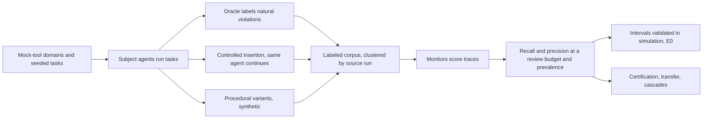

# base-rate

<!-- @prose finding -->


<!-- @table readme-headline -->

**Quickstart (offline, about a minute):**

```bash
git clone https://github.com/raj200501/base-rate && cd base-rate
make setup && make demo
uv run baserate certify --fpr {{param:0.001}} --recall {{param:0.9}}
uv run baserate eval examples/fixtures/monitor_scores.csv --prevalence {{param:1e-4}} --budget {{param:20}}
```

## What it is and is not

base-rate is a library and a study for one question: if violations are rare and humans
can review only a fixed share of agent trajectories, what is a monitor worth? It estimates
recall, precision, and the false-positive rate of a monitor at a review budget and a
deployment prevalence, with intervals that respect how few independent runs stand behind
them; it sizes the labeled samples a claim needs; it checks whether thresholds transfer;
and it optimizes cheap-to-expensive cascades. The study applies it to a labeled corpus of
agent trajectories in eight mock-tool domains and to four monitor families.

It is not a benchmark of frontier models, not an attack on monitors, and not a safety
case. Every trajectory is from simulated tools with abstract violations; the subject
agents and model monitors are small local open-weight models; and the results describe
these monitors on this corpus. The methods transfer to other monitors and data; the
numbers do not.

## Key results

<!-- @prose key-results -->

## How it works



A monitor's scores on labeled benign and violation trajectories are reweighted to a
deployment prevalence; the threshold that reviews exactly the budget is placed (randomized
at ties); recall, precision, and the false-positive rate follow, each with an interval
that resamples or counts whole source runs. Details are in docs/REPORT.md.

## Use it on your own benchmark or agent

Score your labeled trajectories with your monitor and write a CSV with columns
`trace_id`, `label` (benign or violation), `score`, and `cluster` (the independent run each
trace came from). Then:

- `examples/evaluate_your_monitor.py`: recall and precision at a review budget with
  intervals, and the monitor's report card;
- `examples/certify.py`: how many independent runs a recall or false-positive-rate claim
  needs, and how many more an existing claim needs;
- `examples/build_cascade.py`: a two-stage cascade sweep, its Pareto front, and the best
  cascade under a compute budget.

The CLI does the same (`baserate eval`, `baserate certify`, `baserate cascade`,
`baserate card`); docs/USAGE.md explains the score-file format and how to read the
output. The Armour adapter (`baserate.traces.armour`) converts Armour traces.

## Reproduce every figure

```bash
make reproduce
```

rebuilds every figure, table, and number in this README and in docs/REPORT.md from the
banked artifacts under `artifacts/`, with no model calls. `make ship-check` runs the
project's definition-of-done gates on a fresh clone.

## Limitations and threats to validity

<!-- @prose readme-limitations -->

## Responsible disclosure

This project measures monitors and does not attack them. All violations are abstract
actions in simulated tools; no real system, credential, or payload is involved, and no
part of the work optimizes agents to evade monitors. It found no exploitable weakness to
disclose; weaknesses of the evaluated monitors are reported as rates.

## Related work

<!-- @prose readme-related -->

## Citation

```bibtex
@software{baserate,
  title = {base-rate: prevalence-aware evaluation of AI agent monitors},
  author = {Kashikar, Raj},
  year = {{date:2026}},
  url = {https://github.com/raj200501/base-rate}
}
```

See CITATION.cff.

## License

MIT (LICENSE). Ported code keeps its notices: raise-v1 tools under Apache {{version:2.0}}
(third_party/raise-v1/), Armour under MIT (tests/fixtures/armour/LICENSE).
