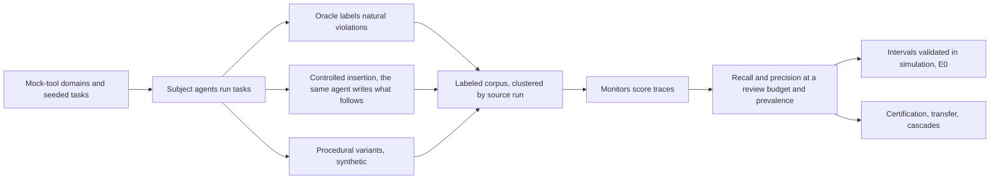

# base-rate

**What is an AI agent monitor worth when violations are rare and humans can review only a
few trajectories?** base-rate is an open Python library and a preregistered study for that
question. The library estimates a monitor's recall, precision, and false-positive rate at a
fixed human-review budget and a stated violation prevalence, with intervals that respect how
few independent runs stand behind them; it sizes the labeled samples a claim needs, checks
whether thresholds transfer, and optimizes cheap-to-expensive cascades. The study applies it
to {{claim:corpus.total.traces}} labeled agent trajectories in mock-tool domains and to rule
and model monitors, with every result number in this README rendered from a committed artifact.

**At a human-review budget of {{param:20}} per {{param:10,000}} trajectories and a
violation prevalence of {{param:1e-3}}, no single monitor in this preregistered study (three
Armour rule configurations and Qwen3 models from {{name:0.6B}} to {{name:8B}} parameters)
caught more violations than random review would within its {{param:95%}} interval; the best
combination, a rank-mean ensemble of the reviewer-calibrated rule and the {{name:8B}} model,
caught {{claim:e2.ensemble--rank-mean-.recall_at_budget.p0.001.b20}} of them, mostly the
synthetic inserted ones ({{claim:e2.by.violation_source.inserted.ensemble--rank-mean-}} of
inserted and {{claim:e2.by.violation_source.natural.ensemble--rank-mean-}} of natural
violations).** Random review at that budget catches {{param:0.002}}. The corpus is agent trajectories in mock-tool domains,
its inserted violations are synthetic, and the monitors are small local models, so these
numbers describe these monitors on this corpus; the methods are the reusable part.


<!-- @table readme-headline -->

**Quickstart (about a minute; after `make setup` fetches the dependencies, everything runs offline):**

```bash
git clone https://github.com/raj200501/base-rate && cd base-rate
make setup && make demo
uv run baserate certify --fpr {{param:0.001}} --recall {{param:0.9}}
uv run baserate eval examples/fixtures/monitor_scores.csv --prevalence {{param:1e-4}} --budget {{param:20}}
```

## What it is and is not

base-rate is a library and a study for one question: if violations are rare and humans
can review only a fixed share of agent trajectories, what is a monitor worth? It estimates
recall, precision, and the false-positive rate of a monitor at a review budget and a
deployment prevalence, with intervals that respect how few independent runs stand behind
them; it sizes the labeled samples a claim needs; it checks whether thresholds transfer;
and it optimizes cheap-to-expensive cascades. The study applies it to a labeled corpus of
agent trajectories in eight mock-tool domains and to four monitor families.

It is not a benchmark of frontier models, not an attack on monitors, and not a safety
case. Every trajectory is from simulated tools with abstract violations; the subject
agents and model monitors are small local open-weight models; and the results describe
these monitors on this corpus. The methods transfer to other monitors and data; the
numbers do not.

## What is built and validated

- **The library** (`src/baserate`, MIT): recall, precision, and false-positive rate at a
  review budget and prevalence, with cluster-aware intervals; `baserate certify` (how many
  independent runs a claim needs); threshold-transfer checks; cascade sweeps and a
  budget-constrained optimizer; a monitor report card; an Armour trace adapter; a CLI and
  three offline examples. It is covered by a test suite that `make test` runs offline.
- **Validated before use:** E0, a preregistered simulation study, checked the coverage of
  the budget-recall and fixed-threshold interval methods against exact truth on a grid of
  score distributions, sample sizes, prevalences, and budgets. Cells where a method
  undercovers are listed in docs/UNSUPPORTED.md, and the library warns there.
- **The data:** a labeled corpus with step-level violation labels, a datasheet
  (docs/DATA.md), a blind label audit, and a canary string in every record.
- **The integrity checks:** every experiment was preregistered under prereg/ and
  `make prereg-verify` checks from git history that each result came after its plan; no
  number in README.md, docs/REPORT.md, or docs/DATA.md is typed by hand (`make claimcheck`,
  `make freshness`, docs/CLAIMS.md); `make reproduce` rebuilds every result from the banked
  artifacts; `make ship-check` runs the project's definition-of-done gates on a fresh
  clone; and an independent review (`make review`) must end in SHIP.

## Key results

Each result comes from a banked artifact and a preregistration committed before its data
existed; `make prereg-verify` checks the order from git history. Intervals are {{param:95%}}
and resample or count whole source runs. Null and negative results are reported with the
same prominence as the rest.

- **Single monitors are near chance at realistic budgets** ([E2 results](artifacts/e2/results.json), [prereg/0003](prereg/0003-e2-main-study.md)).
  At prevalence {{param:1e-3}} and {{param:20}} reviews per {{param:10,000}}, recall was
  {{claim:e2.reviewer-calibrated.recall_at_budget.p0.001.b20}} for the reviewer-calibrated
  rule, {{claim:e2.qwen3-0.6b.recall_at_budget.p0.001.b20}} for Qwen3 {{name:0.6B}},
  {{claim:e2.qwen3-1.7b.recall_at_budget.p0.001.b20}} for {{name:1.7B}},
  {{claim:e2.qwen3-4b.recall_at_budget.p0.001.b20}} for {{name:4B}}, and
  {{claim:e2.qwen3-8b.recall_at_budget.p0.001.b20}} for {{name:8B}}. The two preregistered
  combinations did better overall, the ensemble
  ({{claim:e2.ensemble--rank-mean-.recall_at_budget.p0.001.b20}}) and the cascade that sends
  the top {{param:5%}} by the {{name:0.6B}} score to the {{name:8B}}
  ({{claim:e2.cascade-qwen3-0.6b-qwen3-8b.recall_at_budget.p0.001.b20}}), but mostly on the
  synthetic inserted violations: on natural violations the ensemble reached
  {{claim:e2.by.violation_source.natural.ensemble--rank-mean-}} and the cascade
  {{claim:e2.by.violation_source.natural.cascade-qwen3-0.6b-qwen3-8b}}, an interval that
  contains the random-review rate.
- **The same monitors look strong on curated records** ([E2 results](artifacts/e2/results.json), [prereg/0003](prereg/0003-e2-main-study.md)).
  On Armour's labeled reference records, at the same prevalence and budget, the
  reviewer-calibrated rule reached recall
  {{claim:e2.reviewer-calibrated.recall_at_budget.p0.001.b20.dataset}} and the {{name:8B}}
  model {{claim:e2.qwen3-8b.recall_at_budget.p0.001.b20.dataset}}. Those records are
  explicit violating actions from a few generator scripts (hence the wide intervals); the
  corpus's violations arise while small agents do ordinary tasks. A monitor's result on
  curated records said little about its value on agent traffic.
- **Why: a decent detector at its own threshold is uninformative at the top of the benign tail** ([E2 results](artifacts/e2/results.json), [prereg/0003](prereg/0003-e2-main-study.md)).
  At its native threshold the reviewer-calibrated rule caught
  {{claim:e2.fixed.reviewer-calibrated.recall}} of violations but flagged
  {{claim:e2.fixed.reviewer-calibrated.fpr}} of benign runs, far more than the budget
  allows. Held to the budget, it reviews only its top score, which a violation is about as
  likely as a benign run to receive, so its recall falls to the review rate.
- **Precision collapses with prevalence** ([E2 results](artifacts/e2/results.json), [prereg/0003](prereg/0003-e2-main-study.md)). At {{param:1e-4}} and the same budget,
  the best precision of any monitor was the ensemble's
  {{claim:e2.ensemble--rank-mean-.precision_at_budget.p0.0001.b20}}: almost every
  reviewed trajectory is benign.
- **Model size did not help at one frozen prompt** ([E2 results](artifacts/e2/results.json), [prereg/0003](prereg/0003-e2-main-study.md)). The size ladder shows no clear
  point where a larger model overtakes the rule monitors (recall at the budget:
  {{name:0.6B}} {{claim:e2.ladder.qwen3-0.6b}}, {{name:8B}} {{claim:e2.ladder.qwen3-8b}}).
- **Thresholds do not transfer across domains** ([E3 results](artifacts/e3/results.json), [prereg/0004](prereg/0004-e3-transfer.md)). A threshold tuned in one domain kept
  the review load within a factor of two of the budget in another domain for a share
  {{claim:e3.H3.1-armour-reviewer-calibrated.share}} of domain pairs for the rule monitor
  and {{claim:e3.H3.1-qwen3-0.6b-q8_0.share}} for Qwen3 {{name:0.6B}}, against a
  preregistered bar of {{threshold:75%}}: not supported for either. A threshold tuned at
  prevalence {{param:1e-2}} did keep its review load at {{param:1e-4}} (ratio
  {{claim:e3.H3.3-armour-reviewer-calibrated-p0.0001.ratio}}
  [{{claim:e3.H3.3-armour-reviewer-calibrated-p0.0001.ratio.lo}},
  {{claim:e3.H3.3-armour-reviewer-calibrated-p0.0001.ratio.hi}}]), as expected when
  reviewed traffic is almost all benign. The recall-transfer hypothesis was supported for
  both (shares {{claim:e3.H3.2-armour-reviewer-calibrated.share}} and
  {{claim:e3.H3.2-qwen3-0.6b-q8_0.share}} of pairs within the preregistered recall gap),
  though for the rule monitor a few pairs, such as those into devops, lose more.
- **A rule filter in front of the {{name:8B}} model beat the {{name:8B}} alone** ([E4 results](artifacts/e4/results.json), [prereg/0005](prereg/0005-e4-cascades.md)).
  On the held-out half of the source runs, the cascade from the reviewer-calibrated rule to
  the {{name:8B}} model reached recall {{claim:e4.p2.recall}} [{{claim:e4.p2.recall.lo}},
  {{claim:e4.p2.recall.hi}}] at {{claim:e4.p2.cost}} seconds of compute per trajectory,
  while the {{name:8B}} alone reached {{claim:e4.p2.alone}} [{{claim:e4.p2.alone.lo}},
  {{claim:e4.p2.alone.hi}}]. Not every cascade did: from the {{name:1.7B}} to the {{name:8B}},
  test recall was {{claim:e4.p4.recall}}. Every cascade's training estimate held on the
  test half (H4.1 supported for all four pairs); the efficiency hypothesis H4.2 held for
  all four too, which says little when the second stage alone catches almost nothing.
- **The corpus and its blind label audit** ([corpus manifest](artifacts/corpus/manifest.json), [label audit](artifacts/corpus/label_audit.json), [prereg/0002](prereg/0002-e1-corpus.md)).
  {{claim:corpus.total.traces}} trajectories from {{claim:corpus.total.runs}} independent
  source runs (synthetic share {{claim:corpus.total.synthetic}}), with every planned
  insertion attempt accounted for ({{claim:corpus.ins.inserted}} inserted of
  {{claim:corpus.ins.attempts}}; every skip was a false completion, either because the task
  was already done at the drawn step or because the subject model wrote no usable
  summary). A blind audit of
  {{claim:audit.n}} sampled labels by Claude subagents given only the monitor view agreed with the corpus label, type, and step on {{claim:audit.agreement}}
  [{{claim:audit.agreement.lo}}, {{claim:audit.agreement.hi}}] of them (docs/DATA.md).
- **The interval methods were validated before use** ([E0 summary](artifacts/e0/summary.json), [prereg/0001](prereg/0001-e0-statistical-engine.md)). The budget-recall and
  fixed-threshold interval methods were checked by preregistered simulation against exact
  truth; cells where a method undercovers are
  listed in docs/UNSUPPORTED.md, the library warns there, and E2 marks estimates that rely
  on them.

## Status

- **Complete:** experiments E0 to E4 ran as preregistered and are banked under artifacts/;
  every result above comes from them, and none comes from an unfinished experiment.
- **Gates:** at commit `19dbd5a`, `make ship-check` printed
  `{{brief:SHIP-CHECK: PASS 14/14}}` on a fresh clone, after the second independent review
  returned SHIP with no blocking issues (artifacts/review/latest.json). The first review had
  blocked the release on five issues, all fixed and recorded in CORRECTIONS.md. That pass
  is qualified: the usage ledger then omitted the session's two `make review` runs, and once
  logged they exceed the project's share of one review run a day, so the usage gate (G14)
  now fails on that day's record until Raj decides how to treat the overrun (STATUS.md,
  "Needs Raj"). This page was also revised after that commit, so the review gate (G12)
  needs a fresh `make review`, which waits for the next day's review allowance.
- **Open:** the non-blocking review issues in docs/REVIEW_LOG.md, among them that
  false-positive-rate intervals at the budget are printed tighter than the benign runs can
  certify and that the three Armour rule configurations score this corpus identically; no
  Claude model has been run as a subject or a monitor (DECISIONS.md D2); and the stretch
  goals (adapters for real agent transcripts, streaming monitors) have not started.

## How it works



A monitor's scores on labeled benign and violation trajectories are reweighted to a
deployment prevalence; the threshold that reviews exactly the budget is placed (randomized
at ties); recall, precision, and the false-positive rate follow, each with an interval
that resamples or counts whole source runs. Details are in docs/REPORT.md.

## Use it on your own benchmark or agent

Score your labeled trajectories with your monitor and write a CSV with columns
`trace_id`, `label` (benign or violation), `score`, and `cluster` (the independent run each
trace came from). Then:

- `examples/evaluate_your_monitor.py`: recall and precision at a review budget with
  intervals, and the monitor's report card;
- `examples/certify.py`: how many independent runs a recall or false-positive-rate claim
  needs, and how many more an existing claim needs;
- `examples/build_cascade.py`: a two-stage cascade sweep, its Pareto front, and the best
  cascade under a compute budget.

The CLI does the same (`baserate eval`, `baserate certify`, `baserate cascade`,
`baserate card`); docs/USAGE.md explains the score-file format and how to read the
output. The Armour adapter (`baserate.traces.armour`) converts Armour traces.

## Reproduce every figure

```bash
make reproduce
```

rebuilds every figure, table, and number in this README and in docs/REPORT.md from the
banked artifacts under `artifacts/`, with no model calls. `make ship-check` runs the
project's definition-of-done gates on a fresh clone.

## Limitations and threats to validity

- **Simulated tools, small agents, abstract violations.** Every trajectory comes from mock
  tools, the subject agents are Qwen3 {{name:1.7B}} and {{name:4B}} on a CPU, and a violation
  is one abstract tool call. Recall here is not an estimate for any deployed agent.
- **Violations do not hide.** Natural violations are small-model mistakes, inserted ones
  are chosen by the harness, and Armour's come from a few generator scripts. No source is an
  adversary, so these rates are not robustness to evasion.
- **Labels.** One oracle labels real and inserted trajectories from tool effects, and the
  blind auditor is a model given the same definitions, not a human expert.
- **Prevalence is a design parameter.** Results at each prevalence reweight the corpus
  (case-control) and assume the benign corpus stands for benign deployment traffic.
- **The benign tail limits every low-budget claim.** Only independent benign runs inform
  the extreme tail; procedural variants share their run's cluster. Estimates that rely on
  an E0 cell where the interval method undercovers are marked.
- **One prompt, no Claude models.** The model monitors share one frozen prompt with no
  tuning, so the ladder compares sizes at that prompt; no Claude model served as a subject
  or monitor in this environment. Cascade costs are CPU seconds on this machine.

docs/REPORT.md section 6 states each threat in full, with the preregistration deviations.

## Responsible disclosure

This project measures monitors and does not attack them. All violations are abstract
actions in simulated tools; no real system, credential, or payload is involved, and no
part of the work optimizes agents to evade monitors. It found no exploitable weakness to
disclose; weaknesses of the evaluated monitors are reported as rates.

## Related work

- **Control monitoring in deployment.** "Practical challenges of control monitoring in
  frontier AI deployments" [@practical-challenges-2025] and the control safety-case sketch
  [@korbak-safety-case-2025] argue that limited review capacity fixes a monitor's
  false-positive rate and that recall then drives safety, and that these quantities must
  be estimated and extrapolated conservatively. They give no estimator, interval, or
  sample size; base-rate supplies that measurement layer.
- **Control settings and monitor benchmarks.** Async Control [@aisi-async-control-2025],
  BashArena [@basharena-2025], LinuxArena [@linuxarena-2026], and SHADE-Arena
  [@shade-arena-2025] score monitors against attackers at a fixed false-positive rate;
  MonitorBench [@monitorbench-2026] and TRACE [@trace-2026] benchmark what monitors can
  detect, and TRACE finds that the benign-to-hacked ratio changes measured detection.
  None estimates recall and precision at a deployment prevalence and review budget.
- **Cascades.** Hua and colleagues [@hua-cascades-2025] combine monitors of different cost
  under one budget. base-rate adds a fixed prevalence and review budget, intervals that
  carry the benign tail's uncertainty, certification sample sizes, and held-out
  validation split by source run.
- **Foundations.** Armour [@armour] provides the trace schema, rule monitors, and labeled
  records. The intervals are standard [@clopper-pearson-1934] [@wilson-1927]
  [@brown-cai-dasgupta-2001] [@rubin-1981] [@hanley-lippman-hand-1983]; the corpus
  datasheet follows [@gebru-datasheets-2021]; the model monitors are Qwen3
  [@qwen3-2025].

docs/REPORT.md section 2 discusses each in more detail.

### References

<!-- @references -->

## Citation

```bibtex
@software{baserate,
  title = {base-rate: prevalence-aware evaluation of AI agent monitors},
  author = {Kashikar, Raj},
  year = {{date:2026}},
  url = {https://github.com/raj200501/base-rate}
}
```

See CITATION.cff.

## License

MIT (LICENSE). Ported code keeps its notices: raise-v1 tools under Apache {{version:2.0}}
(third_party/raise-v1/), Armour under MIT (tests/fixtures/armour/LICENSE).
